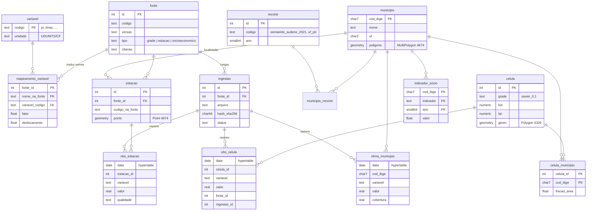

# Proposta do banco de dados — Hub de Dados Climáticos do Semiárido

Documento do passo 6 do plano: modelo de dados, decisões e números do protótipo da Paraíba.

- **Estado:** protótipo funcional com amostra (1 dia, PB, `pr` e `tmax` do BR-DWGD).
- **Ainda não medido:** volume e desempenho em escala (passo 5). Ver [Números do protótipo](#5-números-do-protótipo).

---

## 1. Objetivo

Um banco único com os dados climáticos do semiárido (delimitação SUDENE), que:

- aceite fontes heterogêneas (grades, estações, indicadores socioeconômicos) sem mudar o schema a cada fonte nova;
- responda perguntas por município (`cod_ibge`);
- guarde as informações de cada número (fonte, versão, arquivo, método);
- escale de PB → PB+PE+CE → semiárido inteiro sem redesenho.

## 2. Tecnologia

| Peça | Escolha | Por quê |
|---|---|---|
| Banco | PostgreSQL 17 | Padrão, maduro, auto-hospedável |
| Espaço | PostGIS 3.6 | Polígonos de municípios, células da grade, interseções e áreas |
| Tempo | TimescaleDB 2.30 | Particionamento automático por tempo (hypertables), compressão em colunas, agregados contínuos |
| Imagem | `timescale/timescaledb-ha:pg17` | traz PostGIS + Timescale |
| Migrações | dbmate (SQL puro) | Versionado, sem depender de linguagem, `up`/`down` em cada arquivo |

## 3. Modelo de dados

Além das tabelas:

- **`v_celula_municipio_soma`** (view): soma das frações por município, para conferência.
- **`clima_municipio_mensal`** e **`clima_municipio_anual`** (agregados contínuos do Timescale): soma, média, mínimo, máximo e `n_dias` por município, variável e período.

O schema completo e atual está em [`sql/schema.sql`](../sql/schema.sql), gerado pelo dbmate.

### 3.1 Dimensões

| Tabela | Papel |
|---|---|
| `fonte` | Uma linha por versão de cada dataset (`xavier v_3.2.4`). Versões novas não sobrescrevem as antigas. |
| `variavel` | Catálogo canônico. Unidades em notação UDUNITS/CF (`degC`, `m s-1`). |
| `mapeamento_variavel` | Como cada fonte nomeia cada variável e como converter: `canonico = valor × fator + deslocamento`. |
| `municipio` | `cod_ibge` de 7 dígitos é a chave de município em todo o sistema. Polígono em SIRGAS 2000 (EPSG:4674). |
| `recorte`, `municipio_recorte` | Agrupamentos como dado: UF, delimitação do semiárido de um ano específico, futuramente bacias etc. |
| `celula` | Quadrados de uma grade. `grade` separa grades de resoluções diferentes (Xavier 0,1°, CHIRPS 0,05°, ERA5 0,25°). |
| `celula_municipio` | Ponte grade → município com a fração de área. |
| `estacao` | Estações de medição (ponto). |
| `ingestao` | Cada arquivo carregado: caminho na bronze, hash SHA-256, status, número de linhas. |

### 3.2 Observações (hypertables)

Todas em formato longo, `(data, onde, variavel, valor)`, com `fonte_id` e `ingestao_id`:

| Tabela | Granularidade | Chunk | Compressão (segmentação) |
|---|---|---|---|
| `obs_celula` | célula × dia × variável | 1 ano | `fonte_id, variavel, celula_id`, ordenado por `data` |
| `obs_estacao` | estação × dia × variável | 1 ano | `fonte_id, variavel, estacao_id`, ordenado por `data` |
| `clima_municipio` | município × dia × variável | 5 anos | `fonte_id, variavel, cod_ibge`, ordenado por `data` |
| `indicador_socio` | município × ano × indicador | tabela comum | — |

## 4. Decisões

### Do planejamento (mantidas)

1. **Formato longo.** Variável nova = linhas novas, não colunas novas. Nenhuma migração para acrescentar `tmin` ou uma variável do ERA5.
2. **O banco não escolhe a verdade entre fontes.** Xavier e CHIRPS podem dar chuvas diferentes para o mesmo município e dia. Os dois ficam, cada um com seu `fonte_id`, e quem consulta escolhe.
3. **Rastreabilidade.** Toda observação aponta para uma `ingestao`, que aponta para um arquivo da bronze com hash.
4. **Arquitetura.** Bronze (original) → prata (canônico, validado) → ouro (banco). Arquivo bruto nunca entra no banco.

### Tomadas na implementação

5. **O semiárido é um recorte, não uma coluna.** A delimitação muda (2017, 2021...). `municipio.semiarido` booleano foi descartado em favor de `recorte` + `municipio_recorte`.
6. **`celula.grade`.** Sem isso, células de grades diferentes com o mesmo centro se confundiriam.
7. **`fator` + `deslocamento`.** Conversões como kelvin → °C precisam de deslocamento.
8. **`valor` como `real` (float4).** O Xavier é quantizado em int16 (passo de ~0,007 mm na chuva), então 7 dígitos significativos bastam. A diferença para float8 é de 4 bytes por linha, em bilhões de linhas.
9. **Ausente não vira linha.** O código de ausente (`-32768` no Xavier) é descartado. **Zero de chuva vira linha**, porque é um dado válido.
10. **`variavel` como texto** nas hypertables. Como é coluna de segmentação da compressão, fica guardada uma vez por segmento, e o custo some depois de comprimir.
11. **A grade inteira entra em `celula`**, inclusive células sem dado (mar). A falta de dado aparece em `clima_municipio.cobertura`, em vez de sumir.
12. **`clima_municipio.cobertura`.** A média de um município usa só as células com dado no dia, renormalizando os pesos. `cobertura` = soma das frações dessas células. Quem consulta decide o mínimo aceitável.
13. **Frações em área igual.** A interseção e as áreas são calculadas no PostGIS em `ESRI:102033` (Albers, América do Sul), com bordas das células adensadas (`ST_Segmentize`) antes de reprojetar.
14. **Agregados com várias estatísticas.** Chuva mensal é soma, temperatura mensal é média. O agregado guarda as duas, mais mínimo, máximo e `n_dias` (para saber se o mês está completo).
15. **Atualização dos agregados sob demanda.** Os dados são históricos e chegam em lote, então o pipeline chama `refresh_continuous_aggregate` depois de cada carga, e não há política automática.
16. **Validação antes da prata.** O adaptador valida (unidade declarada, faixas plausíveis, duplicatas) antes de gravar. O que reprova não chega à prata nem ao banco, e gera relatório em `data/relatorios/validacao/`.
17. **Carga idempotente.** Um arquivo com o mesmo hash já carregado com sucesso é pulado. Uma carga que falhou é refeita.

## 5. Números do protótipo

Recorte: Paraíba com 2 células de margem; 1 dia (2024-04-15); `pr` e `tmax` do Xavier v_3.2.4.

| Medida | Valor |
|---|---|
| Municípios carregados | 223 (malha IBGE 2025) |
| Municípios da PB no semiárido (SUDENE 2021) | 198 |
| Células da grade no recorte | 1.134 (27 × 42); 1.100 com dado, 34 sem (mar) |
| Pares célula–município | 1.568 (média de 7 células por município; mínimo de 2) |
| Soma das frações por município | 0,9853 a 1,0000 (ver 6.2) |
| Observações em `obs_celula` | 2.200 |
| Linhas em `clima_municipio` | 446 |
| Pipeline completo, do zero (download → banco) | ~60 s |
| Download da amostra do Xavier | ~300 KB lidos por variável por dia (26 KB gravados) |

Valores de conferência para 2024-04-15:

| Município | `pr` (mm) | `tmax` (°C) | Cobertura |
|---|---|---|---|
| João Pessoa (litoral) | 7,82 | 32,34 | 0,985 |
| Campina Grande (agreste) | 23,06 | 31,78 | 1,000 |
| Sousa (sertão) | 3,10 | 32,80 | 1,000 |

### Ainda não medido (passo 5)

Com um dia de dados, **tamanho em disco, taxa de compressão e tempo de consulta não são representativos**. Exemplo: comprimir o chunk de `obs_celula` hoje **aumenta** o tamanho (328 kB → 1.168 kB), porque cada segmento (fonte, variável, célula) tem uma linha só. A compressão do Timescale só ganha com séries longas por segmento.

Estimativas feitas na fase de planejamento, **a confirmar**:

| | PB+PE+CE | Semiárido inteiro |
|---|---|---|
| Células (0,1°, com margem) | ~3.500 | ~12.000 |
| Linhas em `obs_celula` (1961–2025, 7 variáveis) | ~580 milhões | ~2 bilhões |
| Sem compressão | ~60 GB | ~200 GB |
| Com compressão (10–20×) | ~3–6 GB | ~10–20 GB |

Servidor sugerido: 8 vCPU, 32 GB RAM, 1 TB SSD, mais backup externo. O mínimo para o protótipo dos 3 estados é 4 vCPU, 16 GB RAM e 250 GB SSD.

## 6. Achados sobre os dados

### 6.1 BR-DWGD (Xavier)

- **Distribuição.** Um NetCDF por variável e período (1961–1980, 1981–2000, 2001–2025), cada um com o Brasil inteiro (393 × 391 células), de 1 a 2,6 GB. Disponível no Dropbox (arquivos soltos) e no Google Drive (ZIPs de até 7,2 GB).
- **Formato interno.**
  - Valores em `int16` com `scale_factor`/`add_offset`; ausente = `-32768`.
  - Sem compressão, em blocos de **1 dia × Brasil inteiro**. É isso que permite ler um dia pela rede (HTTP Range) sem baixar o arquivo.
  - Tempo em horas desde 1961-01-01.
  - Coordenadas `float32` dos centros das células (`-7.1499996`), arredondadas para 2 casas na prata.
- **Unidade da temperatura** escrita `"Celcius degrees"` (com erro de grafia). O adaptador confere esse texto exato: se mudar numa versão nova, a validação reprova e alguém olha.
- **Atributo `title`** ainda diz "1961-2020", mas o arquivo vai até 2025. Não confiar nos atributos globais para o período.
- **Máscara do litoral pelo centro da célula.** Células cujo centro cai no mar ficam ausentes. Por isso municípios do litoral têm cobertura baixa: Baía da Traição 0,47, Lucena 0,60, Cabedelo 0,72.

### 6.2 Grade × malha

- A grade do Xavier termina em −34,8° de longitude, e a PB vai até −34,79° (Ponta do Seixas). Uma faixa do litoral fica fora da grade: João Pessoa soma 0,985 e Conde 0,991. É uma limitação da fonte, não um erro de cálculo, e a `cobertura` reflete isso.

## 7. Limitações conhecidas

- `municipio` não tem `fonte_id`. A procedência da malha está só no manifesto da bronze e em `recorte.referencia`.
- `clima_municipio.ingestao_id` guarda **uma** ingestão (a maior) por linha. Se as células de um município viessem de arquivos diferentes no mesmo dia, as outras não ficariam registradas. Hoje isso não acontece, porque cada arquivo cobre a grade toda.
- A projeção `ESRI:102033` usa o datum SAD69. Para **razões** de área (frações) isso é irrelevante, mas áreas absolutas teriam um pequeno desvio.
- A amostra na bronze é um **recorte** do arquivo original, não o original. Está registrado no manifesto.

## 8. Próximas decisões com a equipe

- Quais perguntas os pesquisadores querem responder (define índices e agregações)?
- Qual delimitação do semiárido é a oficial para o projeto? Hoje é a SUDENE 2021 (lista IBGE, situação 2022).
- O SIGWEB precisa do grid ou só dos municípios?
- Baixar os NetCDF completos ou continuar lendo por HTTP Range?
- Qual cobertura mínima aceitar para publicar um valor municipal?
